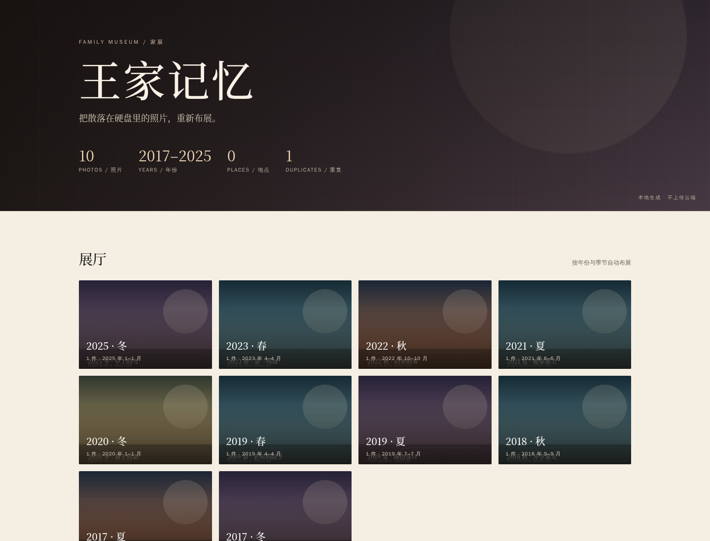
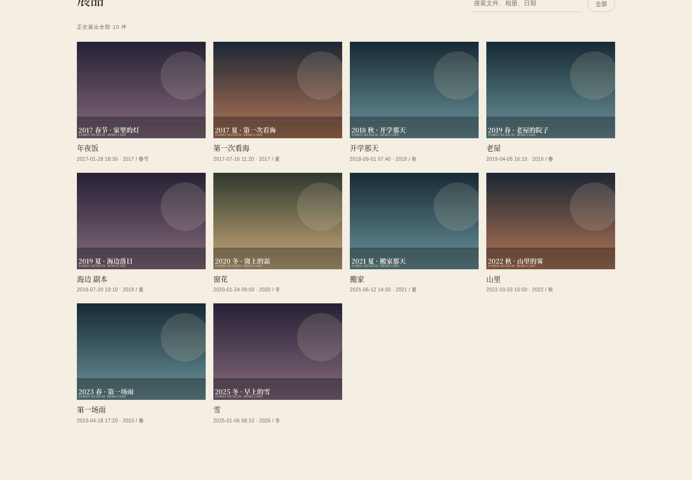

# 家展 · 家庭数字博物馆

> 把散落在硬盘里的照片，重新布展。不是相册，是一座能逛的私人博物馆。

相册让你翻文件夹；家展按年份、季节和相册自动布展，生成一个完全离线的静态页面。照片不上传云端，页面就在你自己的硬盘上。



## 现在能做什么

- 扫描 `jpg / jpeg / png / webp / tif / bmp`
- 读 EXIF 拍摄时间、GPS；读不到就用文件时间
- 按 SHA-256 去重，重复文件计数并保留原图
- 按年份 + 季节自动生成“展厅”，带封面、件数、时间范围
- 按年份生成时间轴，点一下只看那一年
- 搜索文件名、相册、日期
- 生成 520px 缩略图，原图可选复制进博物馆
- 生成完全静态的 `index.html + data.js + thumbs/`，双击就能看
- 暖纸色展览视觉，不是又一堆卡片后台



## 跑起来

```bash
pip install pillow
python -m family_museum build ~/Pictures --out museum --title "我家的博物馆"
```

打开 `museum/index.html`。

常用参数：

```bash
--copy      把原图复制进 museum/originals/（默认只生成缩略图）
--limit 50  只处理前 50 张（调试用）
--open      生成后自动打开浏览器
--json      打印统计 JSON
```

终端输出：

```
博物馆：/path/museum/index.html
照片 10 张 / 重复 1 张 / 年份 2017–2025 / 地点 0 个
```

## 示例数据

`examples/demo-photos/` 里的图片是脚本生成的**抽象照片卡**，不是真实照片：

```bash
python examples/make_demo.py
python -m family_museum build examples/demo-photos --out demo-museum --title "王家记忆" --copy
```

它故意放了一张完全重复的 `海边-副本.jpg`，用来展示去重统计。换成你自己的照片目录即可。

## 结构

```
family_museum/
  build.py    # 扫描、EXIF、去重、缩略图、展厅、静态页
  web/        # 博物馆页面（无框架、无 CDN）
tests/        # 3 项测试：构建、去重、展厅分组
examples/     # 演示照片生成脚本
```

## 边界（重要）

- **不做人脸识别**。现在只按时间、相册、GPS 和文件名组织；人脸聚类是 Roadmap，默认也不会开启。
- **只做完全重复**（SHA-256 相同）。相似照片的 dHash 已经写进数据，但还没有自动合并，避免误删“连拍里最好的一张”。
- **EXIF 依赖相机**。老照片扫描件、微信导出图常常没有拍摄时间，会退回文件修改时间，时间轴可能不准。
- **GPS 只记录坐标**，不做离线地名反查；地点统计是“不同坐标点”的数量，不是“城市数量”。
- **缩略图 520px**。默认不复制原图，灯箱看到的是缩略图；需要高清请加 `--copy`。
- **不支持视频、HEIC、RAW**。HEIC 需要额外解码器，RAW 需要 rawpy，当前不塞进 MVP。

## Roadmap

- [ ] 本地人脸聚类（可选、默认关闭，结果只留在本机）
- [ ] 相似照片分组，让人自己选保留哪张
- [ ] 地图模式：GPS 点在地图上连线成“走过的路”
- [ ] 语音故事卡：给一张照片录一段家人的话
- [ ] 年度家庭年鉴：自动选 30 张，导出 PDF
- [ ] 视频缩略图与时间轴

## License

MIT
